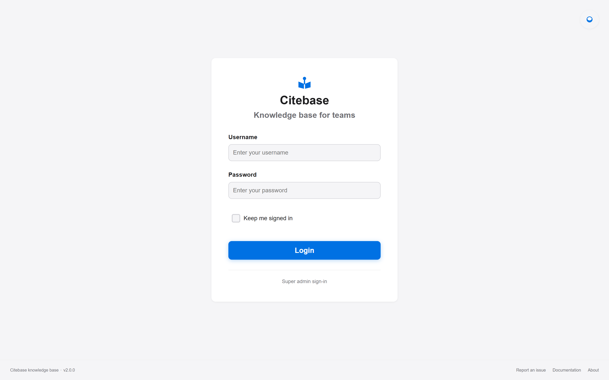
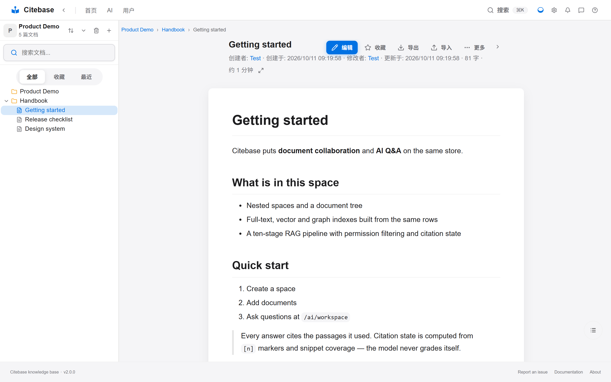
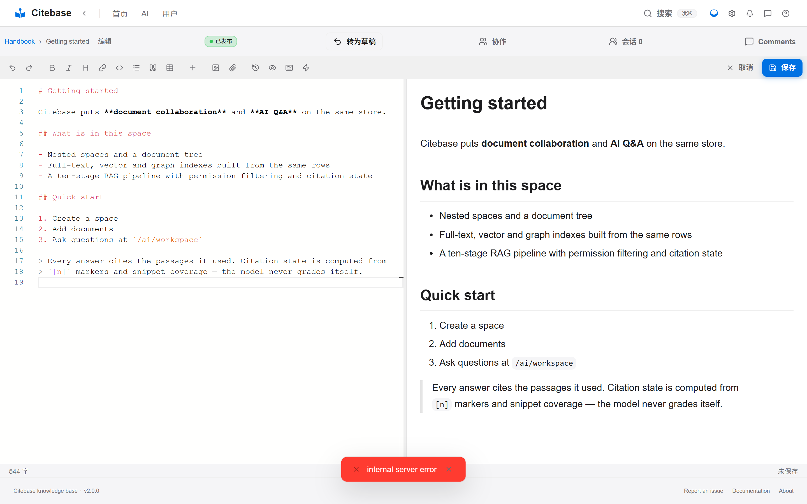
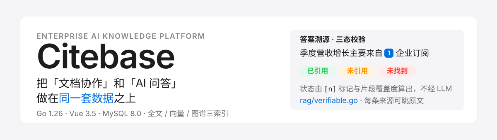
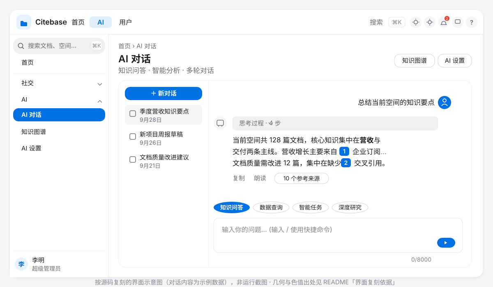
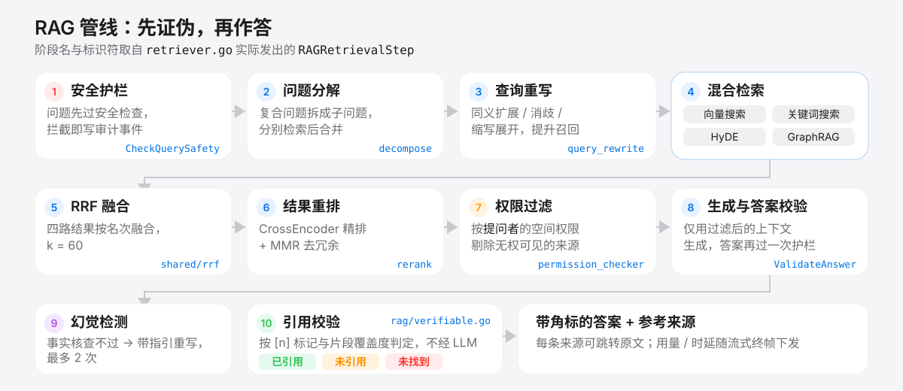

# Citebase

**Enterprise AI knowledge management — wiki, RAG and Text-to-SQL on one data model.**

> Formerly published as **AIWiki**; renamed 2026-10-07. Nothing in the data model changed — Table prefix `aw_` and the `AIWIKI_*` environment variables both still work (the latter as a fallback for `CITEBASE_*`).

English · [简体中文](README.zh-CN.md)

Citebase puts document collaboration and AI question-answering on the same store. Every page in a
knowledge space is indexed for full text, embedded into vectors and added to a knowledge graph; a
RAG pipeline, a Text-to-SQL engine and an agent tool layer then serve retrieval and answers over
that index. The frontend is a Vue 3 SPA built on an Apple-style design system — design tokens plus
inline styles, zero CSS files.

Go 1.26 + Gin + GORM (MySQL) backend · Vue 3.5 + TypeScript + Vite + Pinia frontend.

## What it does

- **Knowledge management** — nested spaces, tree navigation, document versions and cross-references,
  attachments, tagging, approval flows, trash
- **Real-time collaborative editing** — Yjs CRDT over WebSocket, presence and automatic merge
- **Full-text and hybrid search** — Bleve with Chinese tokenisation (gse / jieba), pinyin index,
  vector recall, hybrid fusion and reranking
- **RAG** — ten-stage pipeline: safety guard → semantic cache → question decomposition → query
  rewriting → hybrid retrieval (vector + keyword + HyDE + GraphRAG) → cross-encoder rerank →
  permission filter → generation → hallucination check → citation enrichment
- **Knowledge analyser** — entity extraction and resolution, classification, duplicate and
  contradiction detection, quality scoring, graph construction, incremental and scheduled runs
- **Text-to-SQL** — chain-of-thought generation, execution feedback loop, multiple candidates, AST
  validation, FK discovery, deny-pattern policy, complexity-based model routing
- **Multiple LLM providers** — OpenAI-compatible and Anthropic native, three tiers
  (primary / fast / reasoning), circuit breaker, exponential backoff, SSE streaming, token quotas
- **MCP and agents** — MCP client over stdio / SSE / streamable HTTP, 20+ agent tools, ReAct and
  multi-agent orchestration
- **Enterprise integrations** — OIDC / SSO, Git sync, webhooks, email delivery, SQL data sources
- **Observability** — traces, token usage, RAGAS evaluation, A/B experiments

The authoritative capability list is the source itself: backend routes are registered in
`internal/api/*/routes.go`, frontend pages in `web/src/router/`.

## What the interface looks like

### Real screenshots

Captured from a running instance in the `en-US` locale at 1440×900 — pixels, not drawings.
The content is a throwaway demo space (created for these shots and deleted afterwards), because
shipping screenshots of a real knowledge base would publish somebody's internal document titles.

<p align="center">
  
</p>

<p align="center">
  
</p>

<p align="center">
  
</p>

The chrome that is still Chinese in these shots — side navigation, the toolbar row, the search box —
is the shared shell, tracked in the gaps table below.

### Reconstructed from source — **not screenshots**

The two images below are **not screenshots**. The first is a concept graphic, the second a diagram;
both are rebuilt from the frontend source, and every colour, radius and width in them resolves to a
token in the code — the mapping table at the end of
[README.zh-CN.md](README.zh-CN.md#界面复刻依据) lists each value against its single source file.
They stay as drawings because an AI answer and a retrieval pipeline cannot be photographed honestly
without a live LLM key and a corpus to cite.

<p align="center">
  
</p>

Two invariants worth stating, because they are the parts a demo usually fakes:

- **Permission filtering runs on the asking user's identity, including on the streaming path.**
- **Citation state is computed from `[n] markers and snippet coverage — the LLM never grades itself.**

<p align="center">
  
</p>

<p align="center">
  
</p>

## Requirements

| | |
|---|---|
| Go | 1.26+ |
| Node.js | `^20.19.0 \|\| >=22.12.0` |
| Database | MySQL 8.0 (utf8mb4); Redis optional |

## Quick start

### From source

```bash
# 1. Config
cp configs/config_sample.yaml configs/config.yaml
#    then edit database.dsn and the AI provider block

# 2. Database (table.sql contains DROP TABLE — empty database only)
mysql -u root -p -e "CREATE DATABASE citebase DEFAULT CHARSET utf8mb4 COLLATE utf8mb4_unicode_ci"
mysql -u root -p citebase < databases/table.sql
mysql -u root -p citebase < databases/data.sql

# 3. Backend on :3001
go run ./app/server

# 4. Frontend on :3000 (proxies /api/v1 to the backend)
cd web && npm install && npm run dev
```

Open <http://localhost:3000>. The first visit runs an installer that creates the admin account and
site config.

### With Docker

```bash
cp .env.example .env      # set MYSQL_ROOT_PASSWORD / MYSQL_PASSWORD (compose refuses to start without them)
docker-compose up -d      # MySQL + Redis + app
docker-compose logs -f app
```

For production reads, set `JWT_SECRET` (≥32 random chars) and the encrypt key, and fill in
`server.trusted_proxies` if you terminate TLS behind a proxy — see [SECURITY.md](SECURITY.md).
The encrypt key has two names: `CITEBASE_ENCRYPT_KEY` is the current one, `AIWIKI_ENCRYPT_KEY` is
accepted as a fallback so pre-rename deployments keep working. Which one you put in `.env` is not
free — `docker-compose.yml` forwards the legacy name specifically because existing `.env` files use
it, so for the container path keep `AIWIKI_ENCRYPT_KEY`; when you run the binary directly, either works.
AI settings use the **unprefixed** variables (`AI_ENABLED` / `AI_PROVIDER` / `AI_BASE_URL` /
`AI_API_KEY` / `AI_MODEL`); `docker-compose.yml` passes them through. The encrypt key matters
most beyond a single container: left empty, each replica generates its own key at `data/.encrypt_key`,
and a secret encrypted by one pod cannot be decrypted by another.

### Commands

`make` targets exist but GNU make is not installed everywhere (it is absent on a stock Windows
box), so every target has a direct equivalent:

| Goal | make | directly |
|---|---|---|
| Run backend | `make dev` | `go run ./app/server` |
| Build backend | `make build` | `go build -o citebase ./app/server` |
| Go tests | `make test` | `go test ./internal/... ./tools/repocheck/... -count=1` |
| Go lint | `make lint` | `golangci-lint run ./...`, or `gofmt -l .` + `go vet ./...` |
| Regenerate OpenAPI | `make swagger` | `swag init -g app/server/main.go -o docs/swagger` |
| Changelog | `make changelog` | `node tools/gen-changelog.mjs` |
| Frontend gate | — | `cd web && npm run ci` |

Frontend gates (`cd web`): `npm run lint:check`, `npm run type-check`, `npm run test`,
`npm run check:style` (five design gates: tokens, theme contract, design doctrine, WCAG contrast,
layout contract), `npm run build`. Windows helpers live in `scripts/` — `dev.bat` builds and starts
both servers, `package-windows.bat` produces the portable zip and, when Inno Setup is present, the
installer (`docs/release/windows-packaging.md`).

## Layout

```
app/server/           entry and boot orchestration (main.go / ai_init.go / server.go)
internal/api/         HTTP layer            internal/service/    business logic
internal/repository/  data access           internal/model/      models (tables prefixed aw_)
internal/ai/          provider / rag / analyzer / embedding / mcp / …
internal/text2sql/    natural language → SQL
internal/collab/      Yjs collaboration server
web/                  Vue 3 SPA (Apple design system, Ap* components)
configs/              config_sample.yaml    databases/  DDL + seed data
tools/                standalone CLIs       docs/      documentation index
```

Layering rules, the RBAC contract and every convention are in
[AGENTS.md](AGENTS.md) — read it before changing code.

## Known gaps (measured)

Stated with numbers rather than adjectives, because "polish needed" is not actionable.
Last re-run against HEAD: **2026-11-22** — `tools/repocheck/release_claims_test.go` recomputes these
and fails if the table drifts or goes stale, because a stale "measured" number is worse than none.

| Gap | Measured | Where it bites |
|---|---|---|
| **No UI translation** | 99 view files; `170` use `$t()` / `useI18n` (counting views **and** shared components — the shell appears on every page); 2,508 hard-coded Chinese characters remain in rendered positions (template text, attribute values, string literals — comments excluded). Done so far: login, AI chat, share, search, profile/settings, the workspace domain, the social pages, the shared shell, every route title, the whole admin area, all fourteen AI settings consoles, twenty-one top-level AI views, the Apple component kit and every shared component, plus every `|| '中文'` fallback slot (154 of them, moved into the `fallback:` namespace on 2026-10-15) | Visitor-facing and admin pages are translated; what is left is mostly script-side literals that need a data-value vs display-value triage, plus sentences split around an interpolation. A runtime pass over every route in the en-US shell (`npm run check:i18n-runtime`, needs both dev servers) now finds **0** code-authored Chinese strings — the budget is pinned at zero, so a new hardcoded string that renders on any of the 51 routes fails the gate; what remains in the 2,508 is script-side literals that only appear behind an interaction, plus user data, which is never translated |
| **Server-produced messages were untranslated** | Closed on 2026-10-12 for both shapes of the problem. Envelope: `245` sites wrote Chinese into `response.Xxx(c, "中文")` across `37` files (`123` distinct strings) — now `138` keyed messages in `internal/response/messages.go` carry `message_key` and **`0` sites are left**; the last 5 were concatenations, which now ride a separate `message_detail` field (a sentence is translated, a reason isn't). Verifier: `serverMessageUnmigratedBaseline = 0` in `tools/repocheck/server_message_test.go`. **Still open, and measured**: `43` sites across `20` files write Chinese straight into *data* fields (`gin.H{"message": "AI Provider 未配置"}`) — `message_key` can't help there, and that count is pinned by `serverMessageFieldBaseline` so it can only fall. Service-layer `errors.New` is no longer a blind spot for the client-visible subset: the `7` strings that actually reached the screen were given sentinels and keys; the rest stay log-only by design | Before this an English UI necessarily showed Chinese for every server error: `err.message` is the only pipe the shell has (error pages, toasts, the login error slot). English text lives in `web/scripts/server-messages.en.json`; `web/src/i18n/locales/server-messages.ts` is generated (`npm run gen:server-messages`) |
| **OpenAPI covers ~¼ of the API** | 125 `@Router` annotations over 513 route registrations; `docs/swagger` has 108 paths | `internal/api/ai` (197 registrations, 1 annotation) and `internal/api/schema` (37, 0) are effectively undocumented. Note: `docs/swagger` is generated — after adding an annotation run `make swagger`, otherwise the JSON lags the source |
| **CI has never executed** | `.github/` now carries issue templates only — there is no workflow file, and no run has ever been triggered on the remote; the pre-commit hook is not in the tree either | Enforcement today is the local `make ci` / `npm run ci` pair; a workflow has to be restored and verified before any remote check can exist |
| **Reverse proxy config is opt-in** | `server.trusted_proxies` defaults to `[]` | Behind a proxy every user counts as one IP, so the 300/min limit becomes site-wide |

The full launch checklist — each item with the command that reproduces it — is
[docs/release/launch-checklist.md](docs/release/launch-checklist.md).

## Security

Report vulnerabilities through a **private** channel, never a public issue: see
[SECURITY.md](SECURITY.md) for the channel, the configuration you must change before production,
the defences that already exist in code, and the weaknesses that are still open.

## Contributing

Start with [CONTRIBUTING.md](CONTRIBUTING.md): environment, which gate covers what, and the repo's
habit of **reverse-verifying every new check** (inject a violation, prove the gate goes red, then
undo the injection with an edit — never with `git checkout`).

## Documentation

The four front-door cards live here at the root; everything else is indexed in
[docs/README.md](docs/README.md) — that index is the only one, don't fork a second list here.

| Doc | Contents |
|---|---|
| [AGENTS.md](AGENTS.md) | Engineering contract: commands, layering, key files, and pointers to the rule and gate detail |
| [README.zh-CN.md](README.zh-CN.md) | 简体中文 README（含界面复刻取值对照表） |
| [CONTRIBUTING.md](CONTRIBUTING.md) | Where to start, what to run, how PRs are reviewed |
| [SECURITY.md](SECURITY.md) | Reporting, required production config, existing defences, open weaknesses |
| [CHANGELOG.md](CHANGELOG.md) | Release history (generated — do not hand-edit) |
| [docs/README.md](docs/README.md) | Documentation index (engineering / gates / release / design / audits / glossary / swagger) |

## License

MIT — see [LICENSE](LICENSE). Citebase's own code is MIT; the third-party components linked into
the shipped binary keep their own licenses (Apache-2.0, BSD, MPL-2.0, ISC) and are listed in
[NOTICE.md](NOTICE.md). That file is generated by `node tools/gen-notice.mjs` from the current
build list and is pinned by `go test ./tools/repocheck/ -run TestNoticeCoversBuildList` — adding a
dependency without regenerating it fails the gate, so the list cannot rot into decoration.
