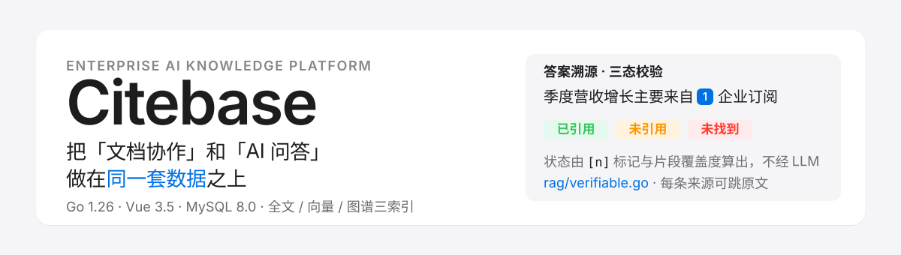
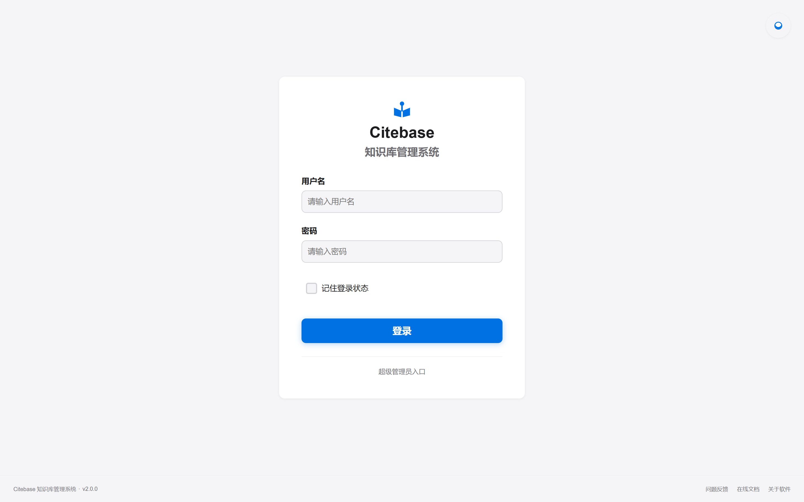
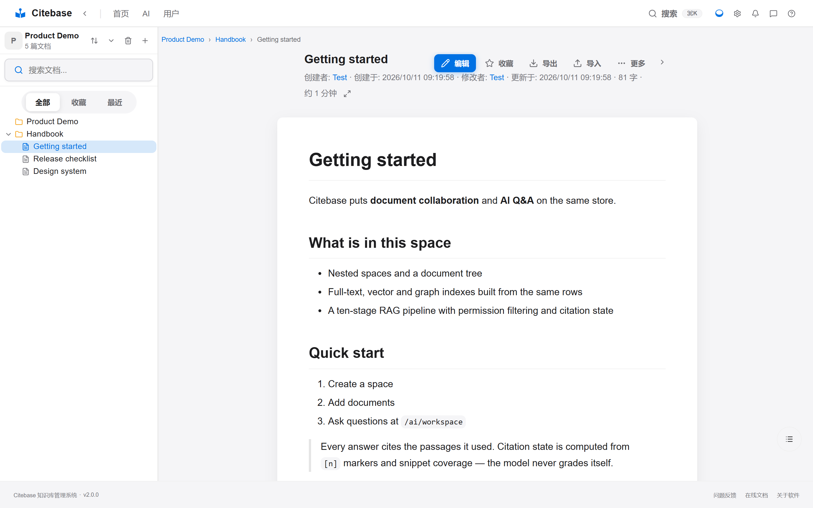
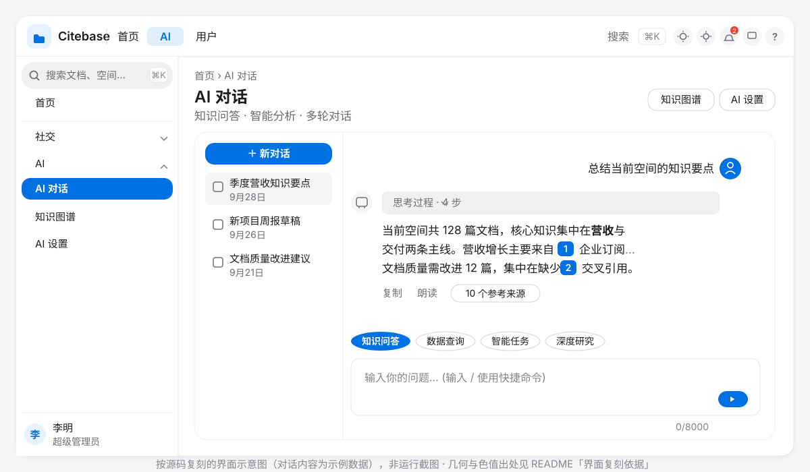
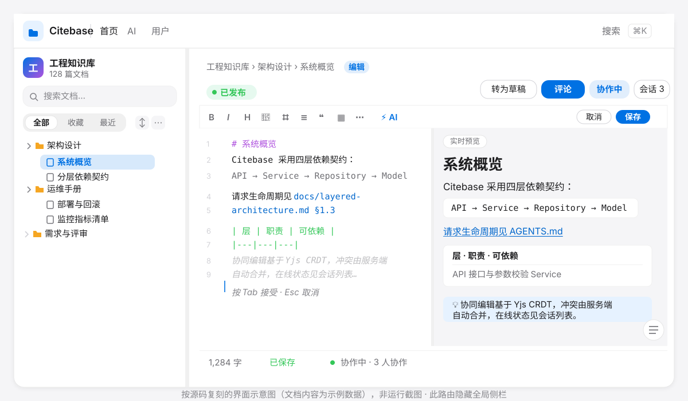
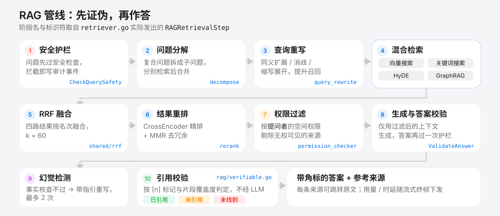

# Citebase

[English](README.md) · 简体中文

> 本项目原以 **AIWiki** 之名开发，2026-10-07 改名为 **Citebase**。数据模型没有变化：表前缀仍是 `aw_`，环境变量旧名 `AIWIKI_*` 仍可用（作为 `CITEBASE_*` 的兜底）。

> 企业级 AI 知识管理与智能问答平台

Citebase 是一个 Go + Vue 3 全栈知识管理系统，把「文档协作」和「AI 问答」做在同一套数据之上：
知识空间里的每一篇文档会自动进入全文索引、向量索引和知识图谱，再由 RAG 管线、Text-to-SQL 和
Agent 工具统一对外提供检索与问答能力。前端采用 Apple 风格设计系统（纯 Design Token + 内联样式，零 CSS 文件）。

<p align="center">
  
</p>

### 一张真截图（不是复刻）

<p align="center">
  
</p>

从跑着的实例上截的像素图，`zh-CN` 档。登录面是第一批接进语言包的页面（英文档见 `README.md`），
其余界面目前仍是中文 —— 下面那些"复刻图"就是因此还留着中文标签。

---

## 核心特性

- **知识管理** —— 多级空间、树形目录、文档版本与交叉引用、附件、标签体系、审批流、回收站
- **实时协同编辑** —— Yjs CRDT + WebSocket 多人同编，在线状态与冲突自动合并
- **全文与混合搜索** —— Bleve 中文分词（gse / jieba）+ 拼音索引 + 向量检索，支持混合召回与重排
- **RAG 检索增强** —— 十步管线：安全护栏 → 语义缓存 → 问题拆解 → 查询改写 → 混合检索
  （向量 + 关键词 + HyDE + GraphRAG）→ 交叉编码重排 → 权限过滤 → 生成 → 幻觉检测 → 引用补全
- **知识分析器** —— 实体抽取与消歧、文档分类、重复/矛盾检测、质量评估、知识图谱构建，支持增量与定时调度
- **Text-to-SQL** —— 自然语言转 SQL，含 CoT 生成、执行反馈修正、多候选、AST 校验、SQL 安全策略与复杂度分级路由
- **多模型 Provider** —— OpenAI 兼容 + Anthropic 原生，三档分层（primary / fast / reasoning），
  熔断、指数退避、SSE 流式、Token 配额
- **MCP 与 Agent** —— MCP 客户端（stdio / SSE / streamable HTTP），20+ Agent 工具，ReAct 与多 Agent 编排
- **企业集成** —— OIDC / SSO 单点登录、Git 同步、Webhook、邮件投递、SQL 数据源接入
- **可观测** —— 调用链路、Token 用量统计、RAGAS 评估、A/B 实验

能力清单以源码为准：后端看 `app/server/server.go` 的路由注册（`internal/api/*/routes.go`），
前端看 `web/src/router/`。（`docs/features.md` 已在 2026-09-29 的清理提交里删除。）

## 界面长什么样

### 真截图

<p align="center">
  
</p>

上面这张是从跑着的实例上截的像素图（1440×900，`zh-CN` 档）。**内容是临时造的演示空间**，
拍完已经删干净 —— 把真实知识库的文档标题截进公开仓库，等于把内部系统清单公开。
登录页的真图见 `README.md`（英文档）。

### 复刻示意图（**不是截图**）

下面两张图**不是运行截图**，是按前端源码逐项复刻的示意图——对话与文档内容均为示例数据。
本仓库不虚构截图；每个色值、圆角、宽度都能在代码里指到出处，对照表见本节末尾。
留成示意图的两处，是"没有真 LLM key 和真实语料就没法诚实拍照"的那两面：AI 回答与检索管线。

### AI 对话 `/ai/workspace`

<p align="center">
  
</p>

### 文档编辑与协同 `/space/:spaceId/doc/:docId/edit`

<p align="center">
  
</p>

### 界面复刻依据

| 图里的东西 | 真实取值 | 唯一实现处 |
|---|---|---|
| 顶栏 48px + 玻璃 + 0.5px 下边框 | `AppleLayout.shellBarHeight`（顶栏 = 页脚 = 侧栏用户行同高）、`cv('surface-chrome')`、模糊强度走 `cv('glass-blur')` | `apple-tokens.ts` · `ApNavBar.vue` |
| 侧栏 240px、白底、1px 右边框 | `sidebarWidth: '240px'` | `ApSidebar.vue` |
| 侧栏搜索框 radius 18 / bg `#f0f0f0` | `AppleRadius.card` + `cv('bg-tertiary')` | `ApSidebar.vue` |
| 导航项 = `ApButton size="small"` | h32 / padding `0 12px` / 13px 字 / radius 13 | `AppleButtonSize.small` · `ApButton.vue` |
| 选中导航项蓝底白字 | `variant="primary"` → `#0071e3`（暗色 `#0a84ff`） | `ApSidebar.vue` |
| 会话列表 220px 固定不收缩 | `flexShrink: 0` | `ChatSidebar.vue` |
| 对话卡片 radius 18 + 1px `#f0f0f0` | `AppleRadius.card` | `styles/component/chat-styles.ts` |
| 行内引用角标（蓝底白字小方块） | bg `var(--apple-blue)`、11px semibold、h18 | `ChatMessageBubble.vue` |
| 三态徽标 已引用 / 未引用 / 未找到 | `#e6f9ef`+`#34c759` / `#fff3e0`+`#ff9500` / `#ffebeb`+`#ff3b30`，radius 6 | `ChatSourcesModal.vue` |
| 「思考过程 · N 步」折叠块 | bg `#f0f0f0`、radius 8、12px 字 | `ChatMessageBubble.vue` |
| 意图胶囊（知识问答 / 数据查询 / 智能任务 / 深度研究） | `AppleRadius.pill` = 980px | `ChatInputBar.vue` |
| 文档树侧栏 300px（可拖 280–400）+ 6px 手柄 | `useResizable({ initialWidth: 300, minWidth: 280, maxWidth: 400 })` | `SpaceView.vue` |
| 树节点行高 26 / radius 8 / 缩进 `level * 16`（上限 80） | — | `TreeNode.vue` |
| 选中行 16% 蓝底 + 蓝字 | `--apple-blue-selection-strong: rgba(0,113,227,0.16)` | `TreeNode.vue` |
| 文件夹图标色 | `--apple-folder-icon: rgb(245,166,35)` | `apple-tokens.ts` |
| 编辑器 / 预览分栏，5px 手柄，默认比例 0.5 | clamped 0.2–0.8 | `DocumentEditor.vue` |
| AI 幽灵文本（斜体、50% 透明）+「按 Tab 接受 · Esc 取消」 | `.ai-ghost-text` | `MonacoEditor.vue` |
| 右下 36px 圆形目录按钮 → 220px 面板 | `PANEL_WIDTH = 220` | `FloatingToc.vue` |
| 正文 17px / 页标题 21px / 微标签 12px | `AppleType.bodyPrimary` / `pageTitle` / `microUI` | `apple-tokens.ts` |

> **文字尺寸是唯一被刻意改动的地方**：真实界面 12–13px 的标签在图里按 14–16 画，
> 否则在 GitHub 窄栏（约 900px）下不可读。几何、色值、圆角、边框、层级关系均为 1:1。
> 深色模式同源：`[data-theme='dark']` 覆盖块换一套值，结构不变。

### 图里刻意没画的东西

这几项在文档或直觉里存在，但**当前前端代码里没有**，所以不复刻：

- AI 对话页**没有右侧面板**——`AIChatView.vue` 只有会话列表 + 消息列两栏。
- 协同编辑**没有头像堆、没有彩色远端光标**——只有「会话 N」弹层里的 6px 圆点 + 名字，
  和底部状态栏的「`N` 人协作」。Yjs 的 awareness 光标未被渲染。
- 文档页**没有审批状态徽章**——`待审批` / `已通过` 只出现在 `/doc-collab`。
- **没有固定的右侧目录栏**——目录是右下浮动按钮展开的 220px 面板；
  260px 的右侧属性面板默认关闭。
- 回答下方**不显示 token 用量 / 耗时 / 模型名**——流式终帧带了这些数据，但界面未渲染。

## 它怎么工作

<p align="center">
  
</p>

阶段名与标识符取自 `internal/ai/rag/retriever.go` 实际发出的 `RAGRetrievalStep`
（`decompose` / `query_rewrite` / `vector_search` / `keyword_search` / `rerank` / `filter`）
与真实函数名，不是事后补的说明文字。两条不变量：**权限过滤按提问者的身份执行，流式路径也不例外**；
**引用状态由 `[n]` 标记与片段覆盖度算出，不经 LLM 自评**。

## 技术栈

| 层 | 选型 |
|---|---|
| 后端 | Go 1.26 · Gin · GORM |
| 前端 | Vue 3.5 · TypeScript 6 · Vite 8 · Pinia 3 · Monaco Editor |
| 数据库 | MySQL 8.0（utf8mb4） |
| 全文检索 | Bleve v2（gse / jieba 中文分词） |
| 向量存储 | Bolt（内嵌 HNSW）· Chroma · Qdrant |
| 缓存 | 内存 / Redis 7 双模式 |
| 协同 | Yjs CRDT + WebSocket |
| AI | 多 LLM Provider · RAG · GraphRAG · MCP · Text2SQL |
| 部署 | 多阶段 Dockerfile · Docker Compose |

## 环境要求

- Go 1.26+
- Node.js `^20.19.0 || >=22.12.0`
- MySQL 8.0（Redis 可选）

## 快速开始

### 源码运行

```bash
# 1. 配置
cp configs/config_sample.yaml configs/config.yaml
#   编辑 config.yaml 的 database.dsn 与 AI Provider 配置

# 2. 初始化数据库（table.sql 含 DROP TABLE，只能对空库执行）
mysql -u root -p -e "CREATE DATABASE citebase DEFAULT CHARSET utf8mb4 COLLATE utf8mb4_unicode_ci"
mysql -u root -p citebase < databases/table.sql
mysql -u root -p citebase < databases/data.sql

# 3. 启动后端（:3001）
go run ./app/server

# 4. 启动前端（:3000，已代理 /api/v1 到后端）
cd web && npm install && npm run dev
```

浏览器打开 <http://localhost:3000>，首次访问会进入安装向导引导创建管理员与站点配置。

### Docker 部署

```bash
cp .env.example .env
#   MYSQL_ROOT_PASSWORD / MYSQL_PASSWORD 必填（compose 会校验，缺失即拒绝启动）
#   JWT_SECRET 生产环境必须设置为 ≥32 字符随机串，留空会退回本地生成的运行期密钥
docker-compose up -d
docker-compose logs -f app
```

Compose 会拉起 MySQL + Redis + 应用；MySQL 初始化脚本按建表 → 基础数据 → 增量的顺序挂载，
数据卷名为 `mysql_data` / `redis_data` / `app_data`。

## 常用命令

```bash
make help            # 全部 Make 目标
make dev             # 后端开发服务
make dev-frontend    # 前端开发服务
make build-all       # 构建后端二进制 + 前端资源
make test            # Go 测试
make lint            # golangci-lint（无则 gofmt + go vet）
make ci              # 完整门禁：lint + test + build + 前端构建
make swagger         # 重新生成 OpenAPI 文档
make docker-up       # Compose 启动

cd web && npm run ci # 前端门禁：lint → type-check → check:style → vitest → build
```

Windows 辅助脚本在 `scripts/` 下：`dev.bat`（构建并启动前后端）、`package-windows.bat`（一条构建链产出免安装包 `citebase-windows.zip`，并在检测到 Inno Setup 时额外产出安装版 `Citebase-Setup-<version>.exe`；没有 Inno Setup 只 WARN，zip 不受影响）。方案、安装/卸载约定与踩坑记录见 `docs/release/windows-packaging.md`。

## 项目结构

```
app/server/           后端入口与启动编排（main.go / ai_init.go / server.go）
internal/api/         HTTP 接口层
internal/service/     业务逻辑层
internal/repository/  数据访问层
internal/model/       模型定义（表前缀 aw_）
internal/ai/          AI 模块（provider / rag / analyzer / embedding / mcp / …）
internal/text2sql/    自然语言转 SQL
internal/collab/      Yjs 协同服务端
web/                  Vue 3 SPA（Apple 设计系统，Ap* 组件）
configs/              config_sample.yaml 配置模板
databases/            建表与初始数据脚本
docs/                 文档（索引见 docs/README.md）
scripts/              Windows 辅助脚本
tools/                独立命令行工具
```

目录树就是上面这份，模块间依赖与分层契约见 [AGENTS.md](AGENTS.md)
（`docs/architecture.md` 已在 2026-09-29 的清理提交里删除，别再去找它）。

## 配置

全部配置项与逐项注释见 [`configs/config_sample.yaml`](configs/config_sample.yaml) ——
它比任何说明文档都新（`docs/configuration.md` 已在 2026-09-29 的清理提交里删除）。

要点：

- 支持环境变量覆盖的键有限（`CITEBASE_DB_DSN`、`CITEBASE_JWT_SECRET`、`CITEBASE_ENCRYPT_KEY`、
  `CITEBASE_REDIS_PASSWORD`、`CITEBASE_ENV`、`CITEBASE_LOG_LEVEL`、`CITEBASE_LOG_FORMAT`、
  `CITEBASE_DATA_DIR`、`CITEBASE_SKIP_MIGRATE`、`CITEBASE_SWAGGER`、`CITEBASE_TRUSTED_PROXIES`、
  `CITEBASE_JIEBA_DICT`）—— 每一项都同时认改名前的 `AIWIKI_*` 写法，**新名优先、旧名兜底**，
  所以改名前已有的 `.env` 不用动。`server.port` 等其余键只能在 YAML 中配置。
- AI 相关走无前缀变量：`AI_ENABLED` / `AI_PROVIDER` / `AI_BASE_URL` / `AI_API_KEY` / `AI_MODEL`
  （注意**既没有 `CITEBASE_` 也没有 `AIWIKI_` 前缀**；`docker-compose.yml` 已把这五个透传进容器）。
- 生产环境务必设置加密密钥（32 字节 AES-GCM）与随机 `JWT_SECRET`。
  ⚠️ 走 Docker 时 `.env` 里请写 `AIWIKI_ENCRYPT_KEY`：compose 转发的就是这个旧名
  （为了不砸改名前已有的部署，见 `docs/release/launch-checklist.md` 第 1.1 条）；
  直接跑二进制时两种前缀都读。
- 放在反向代理后面必须配 `server.trusted_proxies`（或 `AIWIKI_TRUSTED_PROXIES`）：留空时 gin 不读
  `X-Forwarded-For`，全站用户都算代理那一个 IP，300 次/分钟的限流变成整站共享。
- `configs/config.yaml` 与 `.env` 已被 gitignore，只提交模板文件。
- 模板本身有门禁：`internal/utils/config/config_sample_load_test.go` 校验它能被 viper 解析
  （同一映射里的重复键会让**照着文档装的人一个都起不来**），并逐键比对 `server.*` / `database.*`
  在结构体里有对应字段（viper 对认不出的键**静默丢弃**，写错一个字母等于这项配置从来没生效）。

## 测试

```bash
go test ./internal/... ./tools/repocheck/... -count=1 -timeout 120s   # 后端（repocheck 管 .github 与 SECURITY.md）
cd web && npm run test                          # 前端单测（Vitest + happy-dom）
cd web && npm run e2e                           # Playwright E2E（Chromium）
```

## 质量门禁

本仓库**没有跑起来的托管 CI**（发布主机已定 GitHub，`.github/workflows/ci.yml` 写得全，
但一个提交都还没推上去：`github.com/listen808/citebase` 现在是**空仓库**（实测 `size=0`、默认分支 `main`），
而本机 `origin` 仍指向 Gitee，所以一次都没触发过），
质量由本地门禁与提交钩子保证：

- `.husky/pre-commit` 依次执行 `lint:check` → `check-style-tokens.mjs` → `type-check` → `vitest`。
  样式那一步只是**五道样式门禁里的第一道** —— 主题契约、设计教条、WCAG 对比度与布局契约
  不在提交时跑，必须显式 `npm run check:style`（`HUSKY=0 git commit` 可跳过单次）。
  ESLint 在钩子里排第一，是因为它报的是 error：2026-10-06 有一条 `no-useless-escape`
  跟着钩子跑过三个提交而无人拦（`eslint .` 不设 `--max-warnings`，267 条 `no-console`
  warning 不会挡提交，这一点是刻意的）
- `npm run check:style` 除令牌注册一致性外，还对若干样式指标做「只降不升」棘轮
- 每条门禁的规则、基线与踩过的坑：静态那五道见
  [`docs/gates/static-gates.md`](docs/gates/static-gates.md)，需要浏览器的那十几台巡检见
  [`docs/gates/runtime-inspectors.md`](docs/gates/runtime-inspectors.md)
- 提交前请自行跑 `make ci` 与 `cd web && npm run ci`
- 判据类改动要**反向验证**：注入一条违例确认门禁真的变红，再撤掉注入。
  写错的正则最坏后果是永远绿，而"永远绿"和"全站干净"打印出来一模一样

## 文档

门面四卡放在根目录，其余全部由 [docs/README.md](docs/README.md) 索引 —— 那份是唯一一份，
别在这里再抄一份清单（三份清单各自漂移是这个仓库上一轮的真实事故）。

| 文档 | 内容 |
|---|---|
| [AGENTS.md](AGENTS.md) | **工程约定卡** —— 命令、分层契约、关键文件，以及规范与门禁明细的指针 |
| [SECURITY.md](SECURITY.md) | 漏洞报告渠道、上线前必须改的配置、代码里已有的防线、**已知还没解决的问题** |
| [CHANGELOG.md](CHANGELOG.md) | 更新日志（`node tools/gen-changelog.mjs` 从 git log 生成，勿手编） |
| [CONTRIBUTING.md](CONTRIBUTING.md) | 贡献者入口：改哪类跑哪道门禁、反向验证约定、可上手的三块欠账 |
| [docs/README.md](docs/README.md) | 文档索引（engineering / gates / release / design / audits / glossary / swagger） |

## 许可

MIT License，详见 [LICENSE](LICENSE)。
